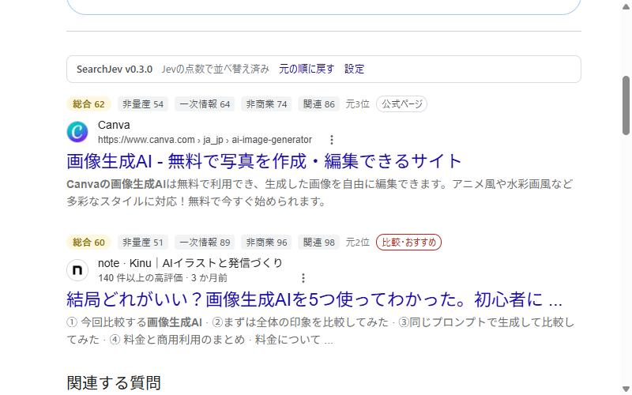

# SearchJev

Google検索結果を AI（TypeSafe の判定モデル **Jev**）で判定し、SEO・アフィリエイト目的の量産記事を下げ、公式情報や実体験などの一次情報を上げて並べ替える Firefox 拡張です（デスクトップ版・Android 版）。

[addons.mozilla.org からインストール](https://addons.mozilla.org/ja/firefox/addon/searchjev/)



## できること

- 各結果の上に 0〜100 の項目別スコアと総合点を表示し、総合点の順に並べ替える
  - **非量産**：SEO・アフィリエイト目的の量産記事らしくなさ
  - **一次情報**：公式・公的機関・実体験（Q&Aの体験談やファンwikiを含む）・独自データ・専門家の度合い
  - **非商業**：購入・申込への誘導が主目的でないこと（企業のオウンドメディアや比較・ランキング記事は売り込みとみなす）
  - **関連**：検索した人の目的を果たせそうなページか
  - **記事の種類**・**発信者の立場**：種類・立場ごとに上げる／下げるを選べる
- Jevが判定に迷った項目は薄く「?」付きで表示する
- 重みのプリセットと、直前の検索を使ったその場のプレビュー
- 任意の「本文を読む」モード：タイトルだけでは関連度の判断に迷った結果だけ、記事ページの本文を読んで判定し直す
- 広告や「関連する質問」などの位置は変えない。ワンクリックで Google の元の順に戻せる


## 使うのに必要なもの

[TypeSafe](https://typesafe.ai) の APIキー（[コンソール](https://console.typesafe.ai/keys)で作成）。判定の費用は各自の TypeSafe アカウントに請求されます。目安は 1回の検索で約0.2円、1日30回検索して1か月200円前後です（2026年10月時点の公表価格で計算した入力分）。同じ検索結果は数日間キャッシュします。

## 送信されるデータ

検索語と、検索結果のタイトル・説明文・ドメイン・URLのパスを、判定のため api.typesafe.ai に送ります。「本文を読む」をオンにした場合だけ、記事ページを Cookie なしで取得し、本文の冒頭（約2,500文字）と見出しも送ります。APIキーと設定はブラウザ内にだけ保存され、開発者のサーバーには何も送りません。詳しくは [プライバシーポリシー](store/privacy-policy.md)。

## 仕組み

- `extension/content.js`：検索結果を読み取り、スコアを表示して並べ替える
- `extension/background.js`：Jev を呼ぶ（1件につき1回、並列）。質問文とプロンプトインジェクション対策もここにある
- `extension/defaults.js`：既定の重み・総合点の計算・確信度の扱い

Jev は、文章を生成する代わりに「当てはまる確率」「段階評価」「選択肢の確率」を返す判定専用のモデルです。SearchJev は1件ごとに6つの質問をまとめて聞き、その答えを重み付き平均して総合点にします。詳しくは [extension/README.md](extension/README.md)。

## 検証

手でラベルを付けた検証データ（32の検索語・289件）で、各判定が人の判断とどれくらい一致するかを測りました。検索語を半分に分け、質問の聞き方は調整用の半分だけで選び、確認用の半分では一度だけ測っています。

| 確認用での一致（AUC） | |
|---|---|
| 「良い」と「ゴミ」の見分け：Googleの順位だけ | 0.76 |
| 同：SearchJev（タイトルと説明文のみ） | 0.80 |
| 量産記事か | 0.82 |
| 売り込みか | 0.84 |
| 一次情報か | 0.75 |
| 関連度（タイトルのみ → 迷った結果だけ本文を読む） | 0.77 → 0.81 |

検証データには個人の検索語が含まれるため、リポジトリには入れていません。

## 開発

ビルドは不要です。Firefox で `about:debugging#/runtime/this-firefox` →「一時的なアドオンを読み込む…」→ `extension/manifest.json`。

```bash
npx web-ext@8 lint -s extension
```

### リリース（メンテナー向け）

AMO の API キーは `amo-credentials.txt`（1行目=発行者、2行目=秘密鍵、`.gitignore` 済み）に置きます。

1. `extension/manifest.json` の `version` を上げる
2. `extension/` で提出：`WEB_EXT_API_KEY="$(sed -n 1p ../amo-credentials.txt)" WEB_EXT_API_SECRET="$(sed -n 2p ../amo-credentials.txt)" npx web-ext@8 sign --channel=listed --amo-metadata=../store/amo-metadata.json --ignore-files=pagefeatures.js --ignore-files=README.md --approval-timeout=0`
3. 審査状況：`node store/amo-status.mjs`、説明文の更新：`node store/amo-describe.mjs`

## ライセンス

[MIT](LICENSE) © mita-pixels（addons.mozilla.org では femakir4 として公開しています）

---

## English

SearchJev is a Firefox extension (desktop and Android) that re-ranks Google search results with TypeSafe's judgment model Jev. It pushes down mass-produced SEO/affiliate articles, lifts first-hand sources (official pages, real experience, original data), shows per-result sub-scores, and fades out judgments the model is unsure about. It needs your own TypeSafe API key; costs are billed to your TypeSafe account (roughly $0.0015 per search). The UI is in Japanese and it works on google.com / google.co.jp. Licensed under MIT.
